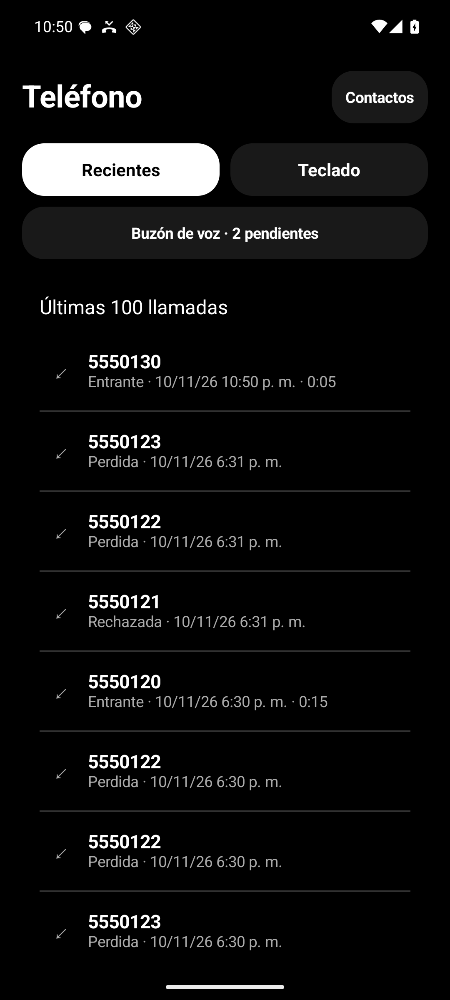
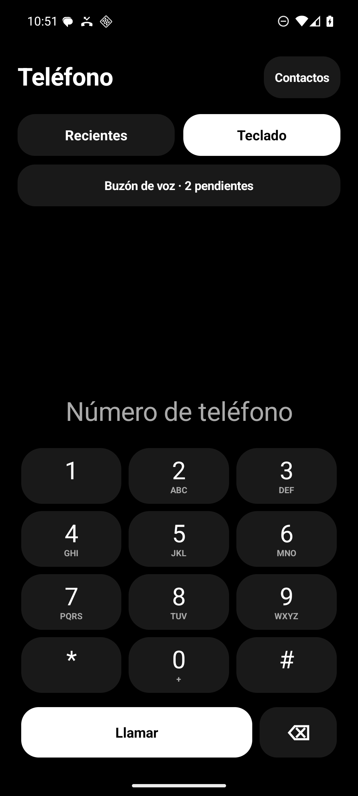
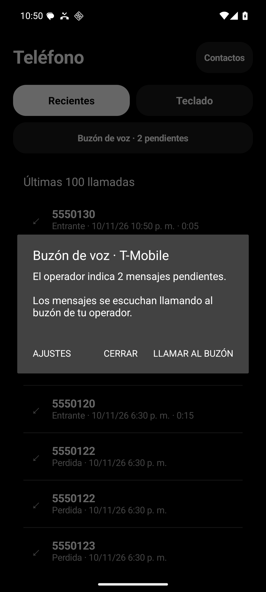
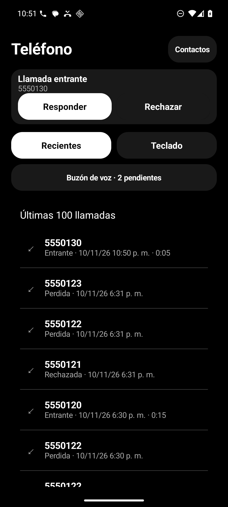
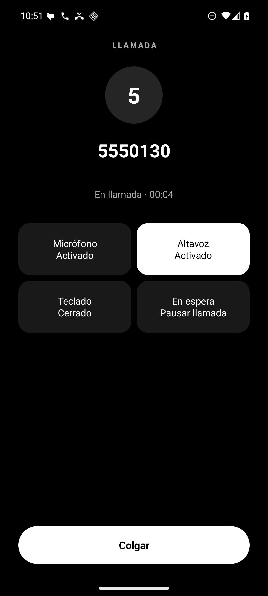

<p align="center"></p>

<h1 align="center">Teléfono Lite</h1>

Marcador nativo para Android, sencillo y ligero, para gestionar llamadas celulares entrantes y salientes. Diseñado en blanco, negro y grises, utiliza los servicios de llamadas y la agenda del sistema.

   

[**Descargar APK 0.3.0**](https://github.com/gustavoamarohidalgo1-ctrl/Telefono10DeNoviembreVersion2/releases/download/v0.3.0/TelefonoLite-0.3.0.apk) · [Ver la versión](https://github.com/gustavoamarohidalgo1-ctrl/Telefono10DeNoviembreVersion2/releases/tag/v0.3.0)

## Pantallas

Capturas de emulador con números sintéticos.

| Recientes | Teclado | Buzón de voz |
|:---:|:---:|:---:|
|  |  |  |

| Llamada entrante | Controles de llamada |
|:---:|:---:|
|  |  |

## Funciones

- Marcación, edición y pegado de números; mantener pulsado el cero escribe `+`.
- Hasta 100 llamadas recientes del registro de Android. Tocar una prepara el número en el teclado; la llamada comienza al pulsar **Llamar**.
- Responder, rechazar y colgar; altavoz, silencio del micrófono, teclado de tonos y espera cuando la red lo permite. **Colgar** permanece visible al abrir el teclado durante una llamada.
- Tarjeta de llamada entrante con **Responder** y **Rechazar** en la pantalla principal, y acceso para volver a una llamada en curso.
- Aviso integrado del buzón del operador, con cantidad pendiente cuando está disponible y acceso para llamar al buzón.
- Identificación mediante los contactos de Android y acceso a [Contactos Lite](https://github.com/gustavoamarohidalgo1-ctrl/Contactos8Noviembre).

Instala el APK, abre la aplicación y selecciónala como teléfono predeterminado. Android puede solicitar permisos para llamadas, notificaciones y pantalla completa; contactos e historial son opcionales. Telecom gestiona la red, las SIM, las llamadas de emergencia y el timbre.

## Buzón de voz

El botón **Buzón de voz** muestra el último aviso recibido del operador para la SIM disponible. Abrirlo no inicia una llamada: para escuchar los mensajes, pulsa **Llamar al buzón**. La integración requiere que Teléfono Lite sea el teléfono predeterminado y tenga el permiso `READ_PHONE_STATE` concedido.

No es un buzón visual: no descarga ni reproduce audios, no lee SMS y no modifica desvíos. El estado refleja el último aviso recibido, no una consulta en directo. La recepción y retirada del indicador dependen de los avisos del sistema y del operador; queda pendiente comprobar el próximo aviso real del operador en el teléfono físico. Más detalles y resultados en [Buzón de voz](docs/BUZON.md).

## Silencio y bloqueador

Teléfono Lite respeta el modo de sonido y No molestar del sistema sin cambiar sus ajustes ni volúmenes. No molestar puede impedir los avisos flotantes o la pantalla completa: no se garantiza su aparición. Con la pantalla principal abierta, la tarjeta entrante permite responder o rechazar.

[Silencio Llamadas](https://github.com/gustavoamarohidalgo1-ctrl/BloqueoActualizado2DeOctubre) es un bloqueador independiente. Teléfono Lite ocupa el rol de teléfono y no cambia los permisos, reglas ni configuración del bloqueador. Las llamadas bloqueadas que Android registre pueden aparecer en Recientes.

## Privacidad y alcance

Sin Internet, anuncios, telemetría, grabación ni servicios permanentes. La agenda permanece en Contacts Provider y el historial se consulta en segundo plano, sin copiarlo ni modificarlo. La aplicación no incorpora un filtro de spam propio.

## Compilar

Se necesitan Bash, Python 3, JDK 17, Android SDK 35 y Build Tools 35.0.0. El wrapper incluido descarga Gradle 8.11.1; no hace falta instalarlo por separado. Configura `JAVA_HOME` y `ANDROID_HOME` para tu equipo. El proyecto no tiene dependencias de producción externas.

```sh
./tools/build.sh
```

El script compila la versión release con reducción de código y recursos, ejecuta Lint y genera el APK y su SHA-256 en `dist/`. Tras descargar las dependencias necesarias, puede usarse `./tools/build.sh --offline`.

Conserva la clave de firma en privado para futuras actualizaciones: nunca subas `.signing/` ni `.local.env`. Un APK firmado con una clave generada por otra persona no puede actualizar el APK firmado con la clave original.

Consulta [Verificación](docs/VERIFICACION.md) para conocer los resultados en emulador y las comprobaciones físicas pendientes.
